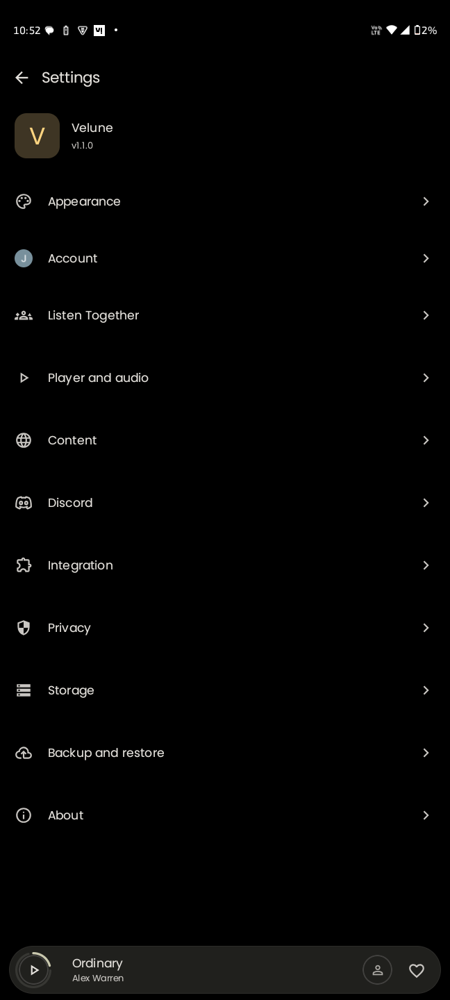

<div align="center">


# OPENBEATS

```
 ██████╗ ██████╗ ███████╗███╗  _nb██╗ █████╗ ████████╗██╗   ██╗███████╗
██╔═══██╗██╔══██╗██╔════╝████╗  ██║██╔══██╗╚══██╔══╝██║   ██║██╔════╝
██║   ██║██████╔╝█████╗  ██╔██╗ ██║███████║   ██║   ██║   ██║███████╗
██║   ██║██╔═══╝ ██╔══╝  ██║╚██╗██║██╔══██║   ██║   ██║   ██║╚════██║
╚██████╔╝██║     ███████╗██║ ╚████║██║  ██║   ██║   ╚██████╔╝███████║
 ╚═════╝ ╚═╝     ╚══════╝╚═╝  ╚═══╝╚═╝  ╚═╝   ╚═╝    ╚═════╝ ╚══════╝
```

### The YouTube Music app you always wanted

**No Ads** | **No Subscription** | **Full Control**

[](https://github.com/HeetSoni26/Openbeats/releases/latest)
[](https://github.com/HeetSoni26/Openbeats/releases)
[](https://github.com/HeetSoni26/Openbeats/stargazers)
[](https://github.com/HeetSoni26/Openbeats/blob/main/LICENSE)


</div>

---

## Download

### Stable Release

| Source | Link |
|--------|------|
| **GitHub** | [](https://github.com/HeetSoni26/Openbeats/releases/latest) |

---

## Why Openbeats?

Openbeats is a **modern YouTube Music client** built with a beautiful glassmorphism UI.

- **Faster** than the official app
- **Ad-free** listening experience
- **Offline-first** with encrypted caching
- **Glassmorphism** design with dynamic mesh gradients
- Built for **audiophiles** and power users

> YouTube Music -- *but unlocked*

---

## Highlight Feature

### Real-Time Synced Lyrics

Experience lyrics like never before:

- Word-by-word sync
- Smooth animations
- Translation support
- Fully immersive playback

---

## Screenshots

| Home | Now Playing | Library | Settings |
|------|-------------|---------|----------|
|  |  |  |  |

---

## Features

### Core Experience

- Ad-Free Playback
- Full Library Sync
- Offline Caching (Encrypted)
- Background Playback
- Sleep Timer

### Audio Engine

- Gapless Playback
- Crossfade Engine
- Silence Skipping
- Loudness Normalization (EBU R128)
- Tempo & Pitch Control
- System EQ Integration

### UI & Discovery

- Glassmorphism UI with mesh gradients
- Material You (Dynamic Colors)
- Synced Lyrics + Translation
- Discord Rich Presence
- Personalized Home Feed
- Year in Review Stats

---

## Architecture

Built using **modern Android engineering principles**:

- MVVM + Clean Architecture
- Unidirectional Data Flow (UDF)
- Modular & scalable codebase

---

## Tech Stack

| Layer | Stack |
|-------|-------|
| **Language** | Kotlin |
| **UI** | Jetpack Compose + Material 3 |
| **Audio** | Media3 / ExoPlayer |
| **Database** | Room (Encrypted) |
| **Networking** | Ktor + OkHttp |
| **Async** | Coroutines + Flow |
| **Build** | Gradle KTS |

---

## Project Structure

```
openbeats/
├── app/
├── innertube/
├── lrclib/
├── kizzy/
├── canvas/
├── lastfm/
├── kugou/
├── betterlyrics/
└── simpmusic/
```

---

## Getting Started

### Requirements

- Android Studio Ladybug+
- JDK 17
- Android SDK 34+

### Run Locally

```bash
git clone https://github.com/HeetSoni26/Openbeats.git
cd Openbeats
```

Open in Android Studio -> Sync -> Run

---

## Community

- **GitHub Issues:** [Report a Bug or Request a Feature](https://github.com/HeetSoni26/Openbeats/issues)
- **GitHub Discussions:** [Open a Discussion](https://github.com/HeetSoni26/Openbeats/discussions)

---

## Credits

Openbeats is built upon the work of several open-source projects. Huge respect to:

- **InnerTune** - Base framework
- **Kizzy** - Discord Rich Presence
- **SimpMusic** - Lyrics integration
- **BetterLyrics** - Enhanced lyrics
- **LrcLib** - Synced lyrics API

---

## Legal

Openbeats is an independent client and is **not affiliated** with YouTube or Google.
Please support artists through official platforms.

Licensed under **GPL-3.0**

---

<div align="center">

**Built with passion by [Heet Soni](https://github.com/HeetSoni26)**

**Star the repo if Openbeats impressed you**

**[Star History](https://star-history.com/#HeetSoni26/Openbeats&Date)**

</div>
